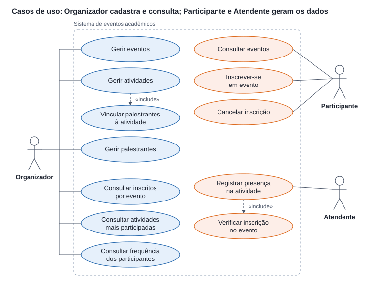
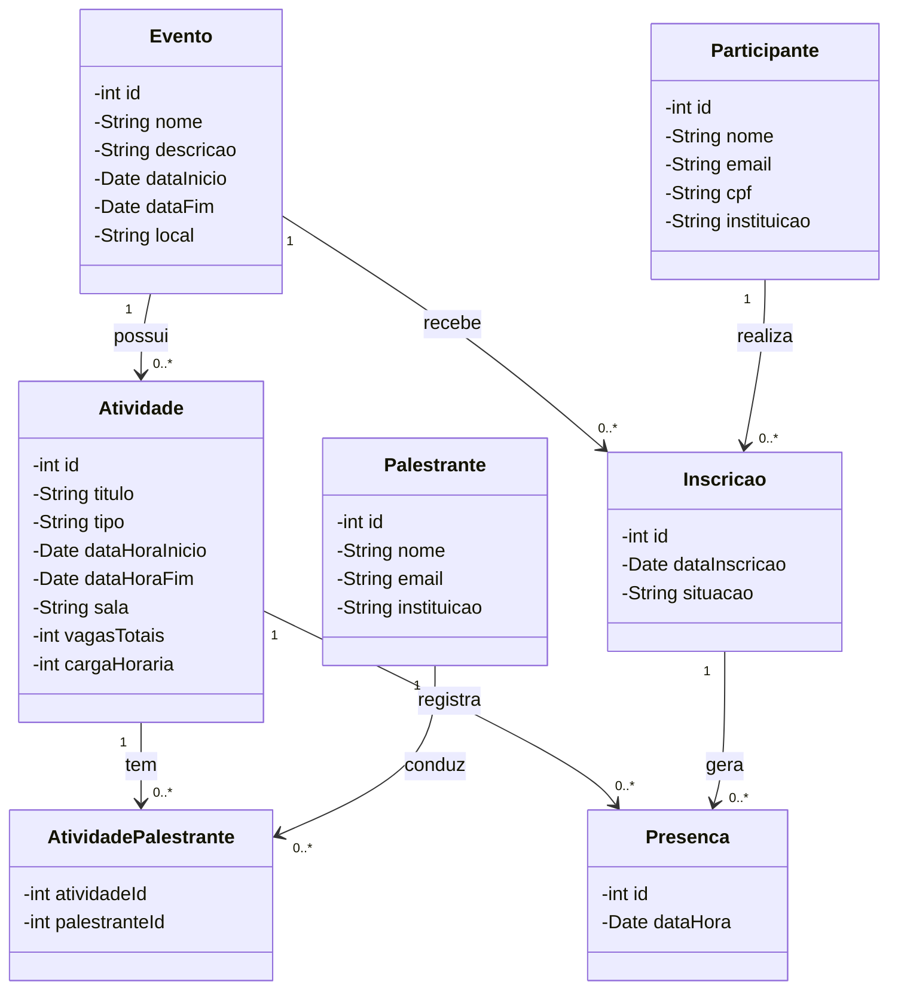
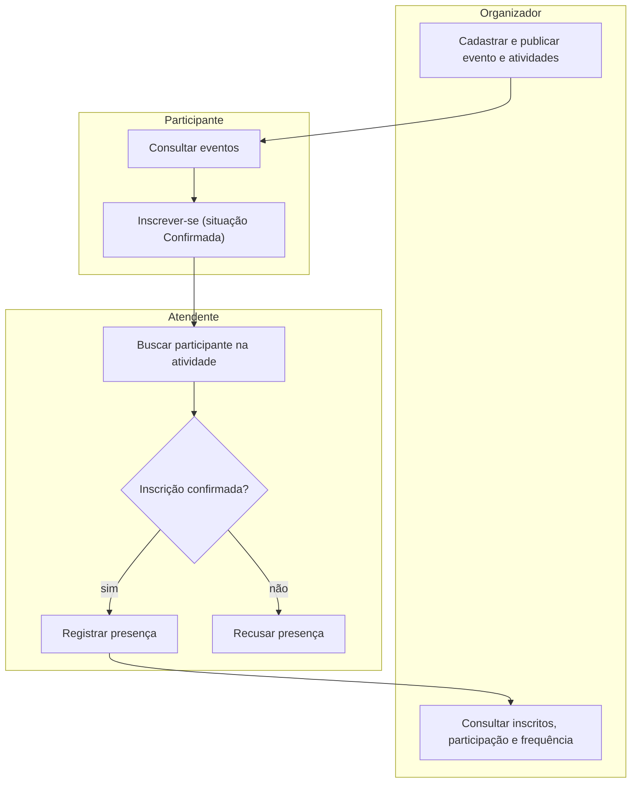

# Especificação Funcional SGEA (Cenário 4: Eventos Acadêmicos)

**Instituto Federal do Triângulo Mineiro — IFTM, Campus Uberlândia Centro**
Versão 2.0 adaptação do SGEA original ao que o Cenário 4 exige: eventos, atividades, palestrantes, inscrições e presença.

## Identificação e histórico de revisões

| Campo | Informação |
| --- | --- |
| Instituição | Instituto Federal do Triângulo Mineiro (IFTM), Campus Uberlândia Centro |
| Projeto | Sistema de Gerenciamento de Eventos Acadêmicos (SGEA) |
| Cliente | Comissão Organizadora de Eventos Acadêmicos |
| Responsáveis | Luanna Naves de Oliveira, Marcelo Cabral Rodrigues, Marianna Peres Castro |

## Sumário

1. [Escopo do projeto](#1-escopo-do-projeto)
2. [Requisitos funcionais](#2-requisitos-funcionais)
3. [Projeto](#3-projeto)

---

## 1. Escopo do projeto

### 1.1. Nome do produto

SGEA — Sistema de Gerenciamento de Eventos Acadêmicos.

### 1.2. Objetivo do produto

O SGEA organiza congressos, seminários e palestras da instituição. Ele cadastra eventos, atividades e palestrantes, registra as inscrições dos participantes com uma situação definida e controla a presença em cada atividade. Com esses dados, a organização consulta o total de inscritos, a participação por atividade e a frequência de cada participante.

### 1.3. Escopo negativo

- O SGEA não processa pagamentos; transações financeiras ficam com gateways externos.
- O SGEA não gerencia hospedagem, passagens ou deslocamento de palestrantes e participantes.
- Backup e recuperação da base de dados ficam com a infraestrutura de TI da instituição.
- Ficam fora desta versão a submissão e avaliação de trabalhos, o credenciamento por QR Code, a emissão de certificados e a gestão de perfis de usuário.

### 1.4. Lista de atores

| Ator | Responsabilidade |
| --- | --- |
| Organizador | Cadastrar eventos, atividades e palestrantes, vincular palestrantes às atividades e consultar os relatórios de inscrição, participação e frequência. |
| Participante | Consultar eventos, inscrever-se em eventos e cancelar a própria inscrição. |
| Atendente | Registrar a presença dos participantes nas atividades, conferindo a inscrição no evento. |

O Palestrante é uma entidade do sistema, cadastrada pelo Organizador, e não um ator: ele não acessa o SGEA.

### 1.5. Requisitos funcionais

| Id. | Requisito | Prioridade | Caso de uso |
| --- | --- | --- | --- |
| RF01 | Cadastrar e configurar eventos (nome, descrição, datas, local e status). | Alta | UC01 |
| RF02 | Cadastrar as atividades de um evento (título, tipo, horário, sala, vagas e carga horária). | Alta | UC02 |
| RF03 | Cadastrar palestrantes e vinculá-los às atividades, com mais de um por atividade. | Alta | UC03, UC04 |
| RF04 | Consultar eventos e atividades publicados. | Média | UC05 |
| RF05 | Inscrever o participante em um evento, com situação definida, e permitir o cancelamento. | Alta | UC06, UC07 |
| RF06 | Registrar a presença de um participante inscrito em uma atividade do evento. | Alta | UC08, UC09 |
| RF07 | Consultar o total de participantes inscritos em cada evento. | Alta | UC10 |
| RF08 | Consultar as atividades com maior participação. | Média | UC11 |
| RF09 | Consultar os participantes que atingiram determinada frequência. | Média | UC12 |

### 1.6. Rastreabilidade

| Requisito | Depende de |
| --- | --- |
| RF01 | Nenhum |
| RF02 | RF01 |
| RF03 | RF02 |
| RF04 | RF01, RF02 |
| RF05 | RF01 |
| RF06 | RF02, RF05 |
| RF07 | RF05 |
| RF08 | RF06 |
| RF09 | RF06 |

### 1.7. Regras de negócio

| Id. | Regra |
| --- | --- |
| RN01 | Um evento possui várias atividades; cada atividade pertence a um único evento. |
| RN02 | Um participante pode se inscrever em vários eventos, e um evento recebe vários participantes. |
| RN03 | Um participante tem no máximo uma inscrição por evento. |
| RN04 | Uma atividade pode ter vários palestrantes, e um palestrante pode atuar em várias atividades. |
| RN05 | Toda inscrição tem uma situação definida: Confirmada ou Cancelada. |
| RN06 | A presença se vincula a uma atividade e a um participante com inscrição Confirmada no evento dessa atividade. |
| RN07 | Cada participante tem no máximo uma presença por atividade. |
| RN08 | Frequência é o percentual de atividades do evento em que o participante teve presença. |
| RN09 | A participação de uma atividade é o número de presenças registradas nela. |

> Estas são as regras de negócio da especificação funcional. O levantamento da Semana 1 ([`semana01.md`](../semana01.md)) tem uma lista própria (RN01 a RN12), com numeração diferente e regras de dados a mais: datas do evento, horário da atividade e CPF e e-mail únicos.

### 1.8. Requisitos não funcionais

| Id. | Categoria | Descrição |
| --- | --- | --- |
| RNF01 | Segurança | Cada ator acessa só as funcionalidades do seu papel: Organizador, Participante ou Atendente. |
| RNF02 | Portabilidade | A aplicação é acessível via web e responsiva para dispositivos móveis. |
| RNF03 | Usabilidade | Interface simples, com a inscrição concluída em poucos passos e a presença registrada por busca de participante. |
| RNF04 | Desempenho | Listagens com paginação de até 15 registros por página e filtros de busca. |
| RNF05 | Integridade | Registros marcados como excluídos (soft delete) não aparecem nas listagens gerais. |
| RNF06 | Integridade | O banco de dados impede presença sem inscrição confirmada e inscrição repetida no mesmo evento. |

### 1.9. Glossário

| Termo | Definição |
| --- | --- |
| Evento | Congresso, seminário ou semana acadêmica, com período e local definidos. |
| Atividade | Palestra, minicurso ou mesa-redonda que compõe a programação de um evento. |
| Palestrante | Pessoa que conduz uma ou mais atividades. |
| Inscrição | Vínculo entre um participante e um evento, com uma situação. |
| Presença | Registro de que um participante inscrito compareceu a uma atividade. |
| Frequência | Percentual de atividades do evento em que o participante esteve presente. |

---

## 2. Requisitos funcionais

### 2.1. Diagrama de casos de uso

O Organizador mantém o cadastro e os relatórios; o Atendente só registra presença, sempre conferindo antes a inscrição no evento.

### 2.2. Documentação dos casos de uso

#### UC01 — Gerir eventos

- **Ator principal:** Organizador
- **Pré-condição:** Organizador com acesso ao sistema.
- **Fluxo principal:**
  1. O organizador escolhe criar um evento ou editar um existente.
  2. Informa nome, descrição, data de início, data de fim e local.
  3. O sistema valida os campos e salva o evento com o status informado.
- **Pós-condição:** Evento salvo; se publicado, aparece na consulta de eventos.

#### UC02 — Gerir atividades

- **Ator principal:** Organizador
- **Pré-condição:** Evento cadastrado.
- **Fluxo principal:**
  1. O organizador seleciona o evento e escolhe incluir ou editar uma atividade.
  2. Informa título, tipo, data e hora de início e fim, sala, vagas totais e carga horária.
  3. O sistema valida os dados e vincula a atividade ao evento.
- **Pós-condição:** Atividade registrada na programação do evento (RN01).
- **Inclusão:** UC04 — Vincular palestrantes à atividade.

#### UC03 — Gerir palestrantes

- **Ator principal:** Organizador
- **Pré-condição:** Organizador com acesso ao sistema.
- **Fluxo principal:**
  1. O organizador escolhe incluir ou editar um palestrante.
  2. Informa nome, e-mail e instituição.
  3. O sistema salva o palestrante.
- **Pós-condição:** Palestrante disponível para vínculo com atividades.

#### UC04 — Vincular palestrantes à atividade

- **Ator principal:** Organizador
- **Pré-condição:** Atividade e palestrantes cadastrados.
- **Fluxo principal:**
  1. Dentro do UC02, o organizador seleciona um ou mais palestrantes.
  2. O sistema grava um vínculo atividade–palestrante para cada selecionado.
- **Pós-condição:** Atividade com seus palestrantes (RN04).

#### UC05 — Consultar eventos

- **Ator principal:** Participante
- **Pré-condição:** Nenhuma.
- **Fluxo principal:**
  1. O participante acessa a lista de eventos publicados.
  2. O sistema mostra nome, datas e local de cada evento.
  3. Ao selecionar um evento, o sistema mostra suas atividades, horários, salas e palestrantes.
- **Pós-condição:** Programação exibida.

#### UC06 — Inscrever-se em evento

- **Ator principal:** Participante
- **Pré-condição:** Evento publicado e participante sem inscrição nele (RN03).
- **Fluxo principal:**
  1. O participante seleciona o evento e escolhe "Realizar inscrição".
  2. O sistema valida os dados cadastrais do participante.
  3. O sistema cria a inscrição com a data atual e a situação "Confirmada".
- **Pós-condição:** Participante inscrito no evento (RN02, RN05).

#### UC07 — Cancelar inscrição

- **Ator principal:** Participante
- **Pré-condição:** Inscrição com situação "Confirmada".
- **Fluxo principal:**
  1. O participante abre "Minhas inscrições" e escolhe cancelar a inscrição.
  2. O sistema altera a situação para "Cancelada" e mantém o registro.
- **Pós-condição:** Inscrição cancelada; o participante não pode mais ter presença registrada no evento (RN06).

#### UC08 — Registrar presença

- **Ator principal:** Atendente
- **Pré-condição:** Atendente com acesso ao sistema; atividade em andamento.
- **Fluxo principal:**
  1. O atendente seleciona a atividade e busca o participante por nome, CPF ou e-mail.
  2. O sistema executa o UC09 para conferir a inscrição.
  3. O atendente confirma a presença e o sistema a grava, vinculada à atividade e ao participante.
- **Fluxo alternativo:** se o participante não tem inscrição confirmada no evento, o sistema recusa a presença e informa o motivo.
- **Pós-condição:** Presença registrada, uma por participante e atividade (RN06, RN07).

#### UC09 — Verificar inscrição no evento

- **Ator principal:** Atendente (incluído no UC08)
- **Fluxo principal:**
  1. O sistema identifica o evento da atividade escolhida.
  2. O sistema procura a inscrição do participante nesse evento e confere se a situação é "Confirmada".
- **Pós-condição:** Resultado da verificação devolvido ao UC08.

#### UC10 — Consultar inscritos por evento

- **Ator principal:** Organizador
- **Pré-condição:** Organizador com acesso ao sistema.
- **Fluxo principal:**
  1. O organizador abre "Relatórios" e escolhe "Inscritos por evento".
  2. O sistema lista cada evento com o total de participantes inscritos (situação "Confirmada").
- **Pós-condição:** Totais exibidos, com paginação e filtros (RNF04).

#### UC11 — Consultar atividades mais participadas

- **Ator principal:** Organizador
- **Pré-condição:** Presenças registradas.
- **Fluxo principal:**
  1. O organizador escolhe "Participação por atividade", opcionalmente filtrando por evento.
  2. O sistema lista as atividades em ordem decrescente do número de presenças (RN09).
- **Pós-condição:** Ranking de atividades exibido.

#### UC12 — Consultar frequência dos participantes

- **Ator principal:** Organizador
- **Pré-condição:** Evento com atividades e presenças registradas.
- **Fluxo principal:**
  1. O organizador escolhe "Frequência", seleciona o evento e informa a frequência mínima desejada, em percentual.
  2. O sistema calcula a frequência de cada inscrito (RN08).
  3. O sistema lista os participantes com frequência igual ou superior ao valor informado.
- **Pós-condição:** Lista de participantes que atingiram a frequência.

---

## 3. Projeto

### 3.1. Diagrama de classes

`Inscricao` liga `Participante` e `Evento`; `AtividadePalestrante` resolve a relação muitos-para-muitos entre `Atividade` e `Palestrante`. `Presenca` aponta para uma `Atividade` e para uma `Inscricao`, o que garante que só participante inscrito no evento da atividade tenha presença.

### 3.2. Diagrama de atividade

Sem inscrição confirmada no evento, o Atendente não consegue registrar a presença (UC08 e UC09); os relatórios do Organizador (UC10 a UC12) partem dessas presenças.

### 3.3. Consultas

As consultas SQL que respondem às questões do cenário (inscritos por evento, atividades com maior participação e frequência dos participantes) ficam no arquivo de consultas SQL do projeto.
