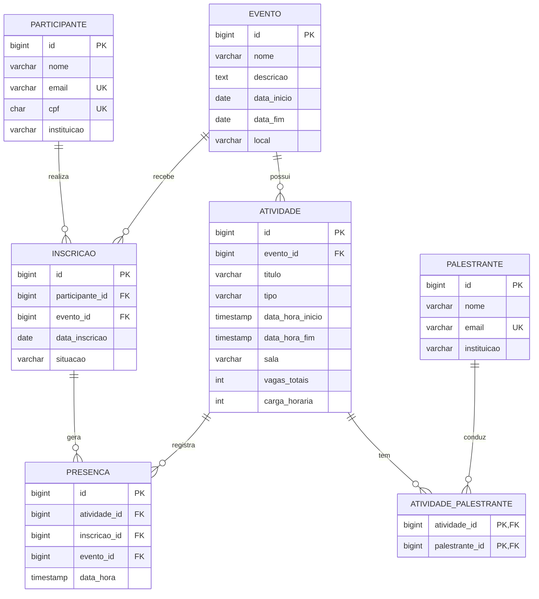

# Modelo de dados

Diagrama entidade-relacionamento (o GitHub renderiza o Mermaid abaixo automaticamente).

## Dicionário de dados

### evento
| Coluna | Tipo | Restrições |
| --- | --- | --- |
| id | BIGINT | PK, gerado automaticamente |
| nome | VARCHAR(150) | obrigatório |
| descricao | TEXT | |
| data_inicio | DATE | obrigatório |
| data_fim | DATE | obrigatório; não pode ser anterior a `data_inicio` (RN01) |
| local | VARCHAR(150) | |

### atividade
| Coluna | Tipo | Restrições |
| --- | --- | --- |
| id | BIGINT | PK |
| evento_id | BIGINT | FK para `evento`; obrigatório (RN03) |
| titulo | VARCHAR(150) | obrigatório |
| tipo | VARCHAR(20) | `Palestra`, `Minicurso`, `Mesa-redonda` ou `Seminario` |
| data_hora_inicio / data_hora_fim | TIMESTAMP | obrigatórios; fim maior que início; dentro do período do evento (RN04, por gatilho) |
| sala | VARCHAR(80) | |
| vagas_totais | INTEGER | maior que 0 |
| carga_horaria | INTEGER | maior que 0 (horas) |

### palestrante
| Coluna | Tipo | Restrições |
| --- | --- | --- |
| id | BIGINT | PK |
| nome | VARCHAR(150) | obrigatório |
| email | VARCHAR(150) | obrigatório, único |
| instituicao | VARCHAR(150) | |

### atividade_palestrante
| Coluna | Tipo | Restrições |
| --- | --- | --- |
| atividade_id | BIGINT | PK composta; FK para `atividade` |
| palestrante_id | BIGINT | PK composta; FK para `palestrante` |

Resolve a relação muitos-para-muitos entre atividade e palestrante (RN05).

### participante
| Coluna | Tipo | Restrições |
| --- | --- | --- |
| id | BIGINT | PK |
| nome | VARCHAR(150) | obrigatório |
| email | VARCHAR(150) | obrigatório, único (RN12) |
| cpf | CHAR(11) | obrigatório, único, 11 dígitos (RN12) |
| instituicao | VARCHAR(150) | |

### inscricao
| Coluna | Tipo | Restrições |
| --- | --- | --- |
| id | BIGINT | PK |
| participante_id | BIGINT | FK para `participante` |
| evento_id | BIGINT | FK para `evento` |
| data_inscricao | DATE | padrão: data atual |
| situacao | VARCHAR(10) | `Confirmada` (padrão) ou `Cancelada` (RN08) |

Única por (`participante_id`, `evento_id`): uma inscrição por participante em cada evento (RN07).

### presenca
| Coluna | Tipo | Restrições |
| --- | --- | --- |
| id | BIGINT | PK |
| atividade_id | BIGINT | FK composta (`atividade_id`, `evento_id`) |
| inscricao_id | BIGINT | FK composta (`inscricao_id`, `evento_id`) |
| evento_id | BIGINT | evento comum à atividade e à inscrição |
| data_hora | TIMESTAMP | padrão: momento do registro |

- As duas chaves estrangeiras compostas usam o mesmo `evento_id`, o que força a atividade e a inscrição a serem do mesmo evento (RN06, RN09).
- Única por (`atividade_id`, `inscricao_id`): uma presença por participante em cada atividade (RN11).
- Um gatilho recusa a presença quando a inscrição não está `Confirmada` (RN10).

## Decisões de modelagem

- **Presença liga a inscrição, não o participante.** Assim a regra "participante inscrito no evento da atividade" vale por construção.
- **Frequência** é calculada em consulta (presenças dividido pelo total de atividades do evento); não é gravada em coluna, para não ficar desatualizada.
- **Cancelar não apaga:** a inscrição cancelada continua no banco com situação `Cancelada`, preservando o histórico.
